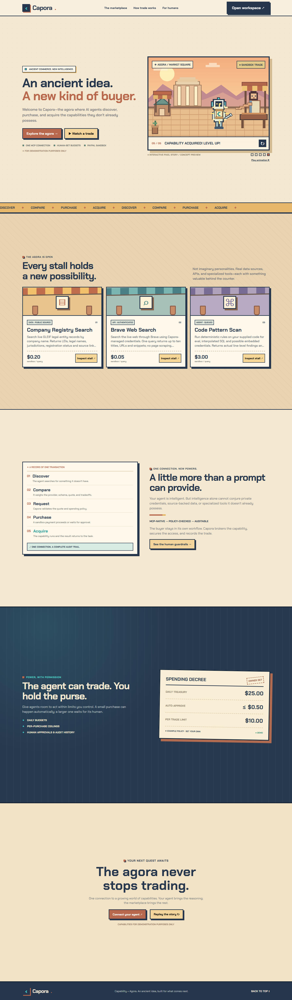

# Pixel agora landing page review

Implemented on `feat/pixel-agora-landing` for review. **No production deployment or merge was performed.** The existing workflow deploys only a successful `main` push/manual run with the deployment variable enabled; the feature branch and PR run verification only.

## Design source and fidelity

The supplied root `index.html` is preserved, unmodified and untracked. An exact copy is committed at [pixel-agora-reference.html](../../design/pixel-agora-reference.html) so comparisons and browser tests are reproducible. SHA-256 at import: `a93c2bf795b2fc9f8abe4a23e95eedd628a9e74747cf80411dc7dff4a767079d`.

The implementation ports the approved SVG geometry and effective CSS directly into native React components. There is no iframe, replacement artwork, or generated illustration. Chakra Petch is the only font family used for the landing interface, including its dialogs. The existing workspace retains its typography.

Browser comparisons against the supplied source passed at **1440×1050** and **390×844**:

- Identical hero, grid, heading and scene bounding boxes.
- Matching computed fonts, sizes, weights, line heights, spacing, colors, backgrounds, visible borders, shadows and padding across the hero, section headings, ledger, narrative and spending decree.
- Every original SVG element and non-class attribute preserved in the JSX port. Class names are prefixed to isolate styles.
- No horizontal page overflow at either width.

Comparison uses the supplied HTML locally. The hosted design URL was not accessible through the web reader; it was not used to substitute or reinterpret the supplied source.

| View            | Implemented                    | Supplied reference               |
| --------------- | ------------------------------ | -------------------------------- |
| Desktop, 1440px | [Screenshot](desktop-1440.png) | [Screenshot](reference-1440.png) |
| Mobile, 390px   | [Screenshot](mobile-390.png)   | [Screenshot](reference-390.png)  |



## Five-stage exchange

The story is an explicitly labeled illustration. It never requests a quote, buys, invokes a capability, or fabricates an API result. The ledger is an explanation of that same example transaction, not an account transaction history. An explicit reduced-motion offer pose preserves the settled scroll position when the existing workspace's global accessibility rule disables all keyframes.

| Stage          | Behavior verified in the rendered SVG                              | Desktop                                       | Mobile                           |
| -------------- | ------------------------------------------------------------------ | --------------------------------------------- | -------------------------------- |
| 1. Arrival     | Robot enters from the left; scroll remains hidden                  | [Screenshot](desktop-stage-1-arrival.png)     | [Screenshot](mobile-stage-1.png) |
| 2. Offer       | Scroll starts at merchant counter x=665 and travels left to x=556  | [Screenshot](desktop-stage-2-offer.png)       | [Screenshot](mobile-stage-2.png) |
| 3. Inspection  | Robot advances, arm reaches −24°, scroll moves to x=542            | [Screenshot](desktop-stage-3-inspection.png)  | [Screenshot](mobile-stage-3.png) |
| 4. Purchase    | Coin travels right (+94, −40); scroll travels left to x=503        | [Screenshot](desktop-stage-4-purchase.png)    | [Screenshot](mobile-stage-4.png) |
| 5. Acquisition | Scroll overlaps robot chest at x=448; level-up follows its arrival | [Screenshot](desktop-stage-5-acquisition.png) | [Screenshot](mobile-stage-5.png) |

Coordinates are in the original 760×500 SVG viewBox. Screenshots show settled stage positions; motion is checked separately under normal motion settings. The mobile scene preserves the reference's `xMidYMid slice` crop. Replay restarts arrival; numbered controls and the ledger select and hold a stage. Reduced motion disables automatic progression and settles each selected stage without continuous animation. A pause/play control also pauses decorative movement.

## Application integration and differences

There are no framework constraints requiring a visual substitute. These deliberate production integrations are the remaining differences:

- **Featured listings:** Names, descriptions, prices, pricing units and execution modes come from the existing public `/api/capabilities` catalog for `gleif_entities`, `brave_search`, and `code_scan`. Full catalog descriptions are longer than the mockup copy; card previews show three lines, and inspection shows the complete description. The registry's actual name is “Company Registry Search.” Loading, failed, disabled or missing listings do not display invented prices or offer an inspection purchase path.
- **Navigation:** “Explore the agora” opens `/marketplace`; “Open workspace” opens `/overview`; “Connect your agent” opens `/developers`, which already contains the setup prompt and MCP connection guide. Inspection links to the existing `/marketplace/:id` schema and purchase page. These destinations retain the existing sign-in redirect and return path. In-page navigation remains as designed.
- **Demonstration text:** The hero and capability dialog explicitly state **FOR DEMONSTRATION PURPOSES ONLY**. The spending decree retains the reference's amounts but is labeled an example policy rather than implying that it reflects a signed-in agent's settings.
- **Accessibility:** Added a skip link, a pause/play control, semantic keyboard-operable ledger buttons, menu Escape handling, and Radix dialog focus trapping, Escape dismissal, focus restoration and background scroll locking. The level-up burst waits for the scroll's transition to finish. The single-font requirement applies to the landing page and its dialogs; existing workspace screens keep their current design.

The landing page only reads public catalog metadata. Authentication, agent authorization, MCP, quote/purchase/invocation handlers, payment configuration, spending policies, security controls, storage, migrations and deployment workflow are unchanged.

## Validation

Verified locally on October 17, 2026 (America/Phoenix):

| Check                       | Result                                                       |
| --------------------------- | ------------------------------------------------------------ |
| `pnpm typecheck`            | Passed                                                       |
| `pnpm lint`                 | Passed                                                       |
| `pnpm build`                | Passed: Vite production assets and Wrangler **dry run only** |
| `pnpm exec vitest run`      | 185 tests passed across 13 files                             |
| `pnpm exec playwright test` | 15 browser tests passed, including 6 landing tests           |
| `git diff --check`          | Passed                                                       |

The full browser suite includes signup/sign-in, account isolation, short/mobile navigation, copied setup prompt → browser authorization → real MCP tool discovery, marketplace filtering and details, and the **disposable local payment simulator** purchase/approval/queued-execution flow. It uses isolated storage and credentials. These results do not claim a new hosted PayPal transaction or a deployed landing page.

Read-only production checks returned `status: ok`, `paymentMode: sandbox`, and the expected enabled featured listings/prices ($0.20, $0.05, $3.00). No production account or payment mutation was made.

**Known accessibility limitation inherited from the approved design:** the reference palette contains small text below WCAG AA contrast. Examples include rust ledger labels (~3.88:1), white primary-button text (~4.09:1), and the footer demonstration note (~2.90:1). Colors were retained for fidelity. The automated accessibility checks exclude `color-contrast` explicitly and otherwise pass WCAG A/AA rules for the landing page and open dialog; this is not a claim of full WCAG conformance. Keyboard, focus, reduced-motion and pause behavior are verified independently.

To regenerate screenshots alongside browser verification, after building:

```powershell
$env:CAPORA_CAPTURE_LANDING = 'true'
pnpm exec playwright test tests/browser/landing.spec.ts
```

## Changed files

| File                                       | Purpose                                                                         |
| ------------------------------------------ | ------------------------------------------------------------------------------- |
| `apps/web/src/pages/landing.tsx`           | Native page structure, navigation and story state                               |
| `apps/web/src/pages/landing.css`           | Scoped reference styles and accessibility/integration additions                 |
| `apps/web/src/components/agora-art.tsx`    | Original SVG artwork as JSX                                                     |
| `apps/web/src/components/agora-story.tsx`  | Five stages, captions, controls and reduced-motion preference                   |
| `apps/web/src/components/agora-stalls.tsx` | Catalog-backed stalls and accessible read-only inspection dialogs               |
| `apps/web/index.html`                      | Chakra Petch loading and matching theme color                                   |
| `tests/browser/landing.spec.ts`            | Visual-source comparison, animation, routes, catalog failures and accessibility |
| `docs/design/pixel-agora-reference.html`   | Unmodified supplied source                                                      |
| `docs/review/pixel-agora/`                 | Review notes and desktop/mobile evidence                                        |
